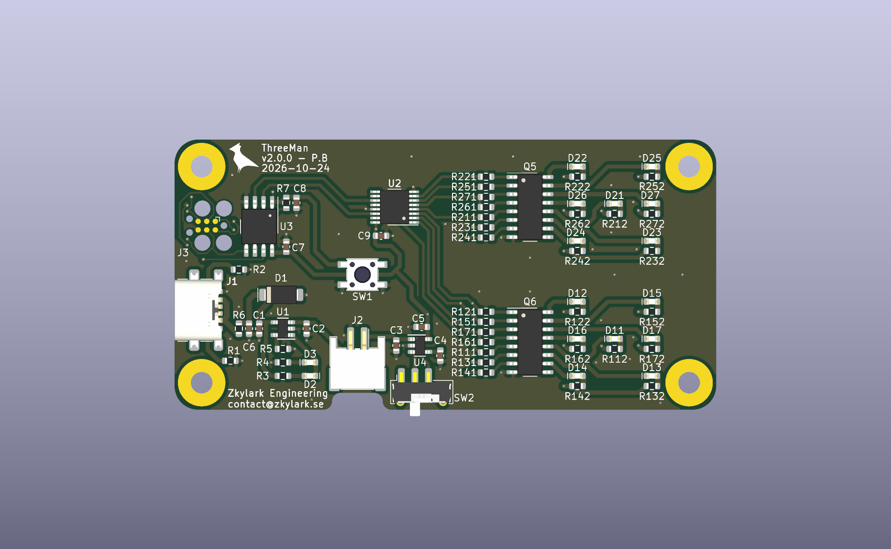
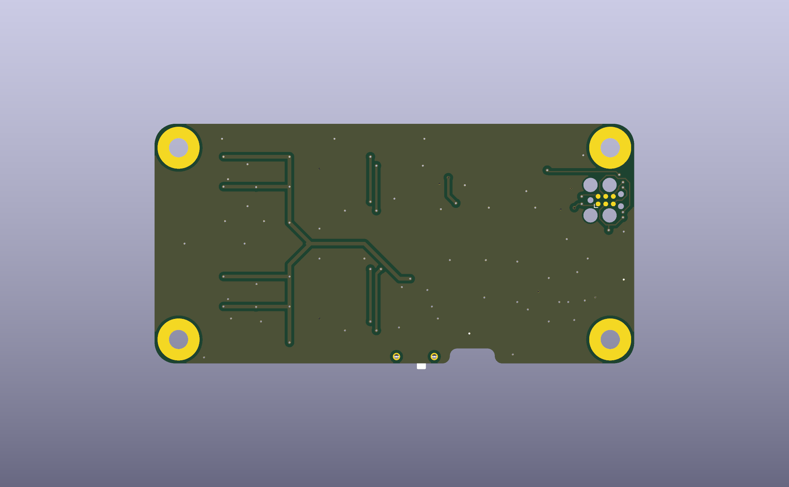

# ThreeMan_HW

## Description
A simple implementation of the "3-man" dice game. Press the button to roll the dice.

|  |  |
| --- | --- |

## Changelog
The format is based on [Keep a Changelog](https://keepachangelog.com/).  

According to Hardware Semantic Versioning (MAJOR.MINOR.PATCH), increment:
* MAJOR - when changing mechanical or connector interfaces
* MINOR - when changing schematic or layout
* PATCH - when changing BOM or sourcing data

All notable changes to this PCB project will be documented in [CHANGELOG.md](CHANGELOG.md).